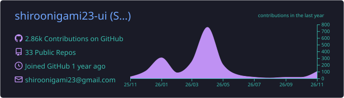
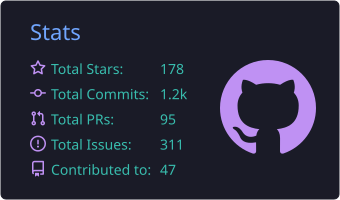
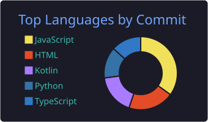
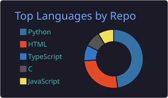
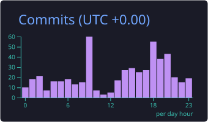

<h1 align="center">ShiroOni23</h1>
<h3 align="center">Developer • Systems Builder • AI/ML Engineer • Security-Oriented Problem Solver</h3>

  
  
  

## About Me
- Building robust products across web, AI/ML, systems programming, and security.
- Working on **AegisOS**: a secure, lightweight, customizable operating system.
- Focus: scalable backend architecture, algorithmic systems, and practical security engineering.
- Open to collaboration on ambitious products and research-grade implementations.

## Connect

  
  
  
  
  

## Tech Stack
### Languages

  

### Frameworks and Libraries

  

### Databases and Cloud

  

### Tools and Platforms

  

## GitHub Analytics

  

  
  

  
  

  

  <picture>
    <source media="(prefers-color-scheme: dark)" srcset="https://raw.githubusercontent.com/shiroonigami23-ui/shiroonigami23-ui/output/github-snake-dark.svg" />
    
  </picture>

Cards are generated inside this repo by GitHub Actions (<code>.github/workflows/profile-cards.yml</code>, <code>snake.yml</code>) twice a day — no external stats server, so they never rate-limit.

## Featured Projects
<table>
<tr>
<td width="50%" align="center"> Verifiable audit chain for AI coding agents</td>
<td width="50%" align="center"> Adversarially-hardened edge vision models</td>
</tr>
<tr>
<td width="50%" align="center"> AI study hub — Next.js, Neon, PWA + Android</td>
<td width="50%" align="center"> D3QN research pipeline → paper, slides, release</td>
</tr>
<tr>
<td width="50%" align="center"> AES-GCM steganography — live on Streamlit</td>
<td width="50%" align="center"> Library management system — web, APK, EXE</td>
</tr>
</table>

  
  
  
  

## Command Center
 Powering my ecosystem dashboard and automation.

- [Status Dashboard](./generated/STATUS.md)
- [Project Showcase](./generated/SHOWCASE.md)
- [Architecture Cards](./generated/ARCHITECTURE_CARDS.md)
- [Sync Script](./scripts/sync_dashboard.py)

---

  <strong>Let's build secure, high-impact systems.</strong>

